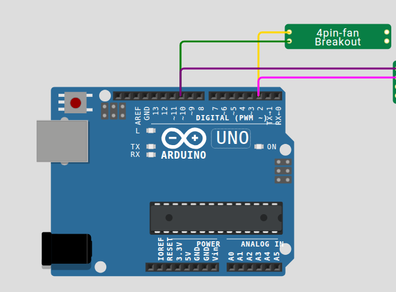

# Wokwi 4-Pin Fan Custom Chip (`chip-4pinfan`)

A [Wokwi Custom Chip](https://docs.wokwi.com/chips-api/getting-started) simulation model for a standard 4-pin PC cooling fan with PWM speed control and tachometer feedback.

---

## Overview

Modern PC cooling fans commonly use a 4-pin interface comprising Power, Ground, PWM control input, and Tachometer output. This custom chip simulates:
* **PWM Speed Control**: Detects the incoming PWM frequency and duty cycle on the `PWM` pin to determine fan target speed.
* **Tachometer Feedback**: Emulates hall-sensor tachometer pulses on the `TACH` pin (2 pulses per revolution) proportional to the effective RPM.
* **Configurable Max RPM**: Allows interactive or programmatic adjustment of the fan's maximum rotational speed.

---

## Pinout

| Pin Name | Direction | Description |
| :--- | :--- | :--- |
| `POWER` | Input | Supply voltage (e.g., 12V or 5V DC reference). |
| `GND` | Input | System ground reference. |
| `PWM` | Input (Pull-up) | PWM control signal from microcontroller (typically 25 kHz target). |
| `TACH` | Output (Low/Pulse) | Tachometer pulse output (2 pulses per rotation). |

---

## Interactive Controls

The chip exposes a dynamic slider control in the Wokwi simulator UI:
* **Max Fan RPM** (`max_rpm`):
  * Type: `range`
  * Range: 500 RPM to 8000 RPM (default: 5000 RPM, step: 500 RPM)
  * Adjusting this changes the baseline scaling for tachometer pulse generation.

---

## Usage in Wokwi

### 1. Add as a Project Dependency

To load this chip automatically into your Wokwi project, add it under `dependencies` in your `diagram.json`:

```json
{
  "version": 1,
  "author": "Your Name",
  "editor": "wokwi",
  "parts": [
    {
      "type": "chip-4pinfan",
      "id": "fan1",
      "top": 0,
      "left": 0,
      "attrs": { "max_rpm": "4000" }
    }
  ],
  "connections": [
    [ "fan1:TACH", "uno:2", "gold", [] ],
    [ "fan1:PWM", "uno:10", "green", [] ],
    [ "fan1:GND", "uno:GND.1", "black", [] ]
  ],
  "dependencies": {
    "chip-4pinfan": "github:Bmiga-1200/wokwi-chip-4pinfan@1.0.0"
  }
}
```

> Replace `@1.0.0` with the target release tag that you are interested to use.

---

## Wiring Diagram

Connect the microcontroller's PWM timer output pin to the fan's `PWM` pin, and an external interrupt pin (e.g. Pin 2 on Arduino Uno) to the fan's `TACH` pin.



---

## Example Arduino Sketch

The following sketch outputs a 25 kHz PWM signal to regulate fan speed while measuring RPM through tachometer interrupt counts:

```cpp
#include <Arduino.h>

const int PIN_TACH = 2;  // External interrupt pin (INT0)
const int PIN_PWM  = 10; // PWM output pin

volatile unsigned long tach_pulse_count = 0;
unsigned long last_measure_time = 0;

void IRAM_ATTR on_tach_pulse() {
  tach_pulse_count++;
}

void setup() {
  Serial.begin(115200);
  pinMode(PIN_TACH, INPUT_PULLUP);
  pinMode(PIN_PWM, OUTPUT);

  attachInterrupt(digitalPinToInterrupt(PIN_TACH), on_tach_pulse, FALLING);

  // Set 50% duty cycle on PWM pin
  analogWrite(PIN_PWM, 128);
}

void loop() {
  unsigned long now = millis();
  if (now - last_measure_time >= 1000) {
    noInterrupts();
    unsigned long pulses = tach_pulse_count;
    tach_pulse_count = 0;
    interrupts();

    // 2 pulses per revolution -> RPM = (pulses / 2) * 60
    unsigned long rpm = (pulses * 30UL) * 1000UL / (now - last_measure_time);
    Serial.print("Measured Fan RPM: ");
    Serial.println(rpm);

    last_measure_time = now;
  }
}
```

---

## Development & Building

### Prerequisites
* [WASI SDK](https://github.com/WebAssembly/wasi-sdk) (version 20.0 or later)
* `make`
* `arduino-cli` (for running test suites)

### Build WASM Binary
```bash
make
```

### Run Automated Tests
```bash
make test
```
The test suite installs the `arduino:avr` core and `AVR_PWM` library, then compiles `tests/uno-pwm-tach/uno-pwm-tach.ino` to verify compatibility.

---

## License

This project is licensed under the [GNU Affero General Public License v3.0 (AGPL-3.0)](https://www.gnu.org/licenses/agpl-3.0.html).
